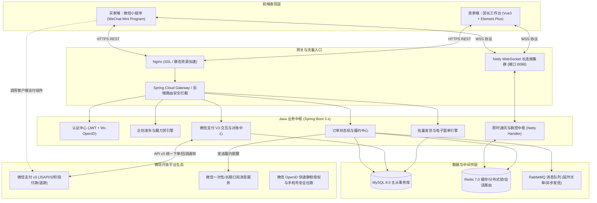
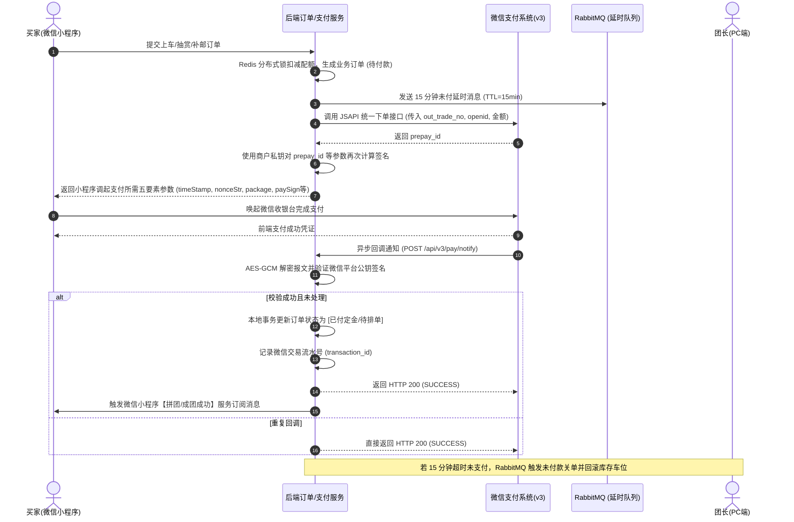
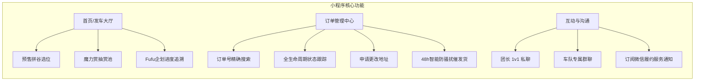
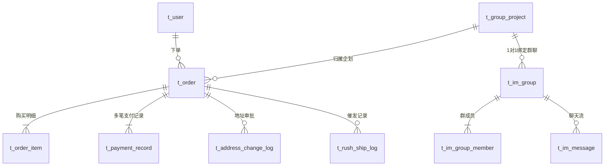

# 「谷车GO」二次元拼团发车与企划履约平台 —— 系统设计说明书（Java + 微信小程序版）

---

## 1. 项目概述与业务背景

### 1.1 业务痛点分析
随着“吃谷”（ACG 角色徽章、立牌等周边）、“抽魔力赏/一番赏”以及“棉花娃娃/Fufu毛绒公仔企划”的流行，二次元拼团已发展为高频青年消费场景。但目前多依赖“闲鱼转转挂车 + 腾讯文档排单 + QQ 群答疑”，存在以下核心痛点：
1. **资金流脱节与跑单风险**：个人转账易发跑单与卷款跑路风险；定金与尾款/补邮分离，缺乏正规分阶段支付与原路退款闭环。
2. **超长工期与履约信息断层**：Fufu 和大货制作工期动辄 3~6 个月，买家跨学期搬迁频繁，改地址混乱导致错发漏发。
3. **团长排单发货负担沉重**：手工匹配数百条运单号极易错发，缺乏面向二次元按角色/捆单分拣的批量打单工具。
4. **社群沟通分散**：QQ 消息极易被刷屏，团长发出的关键补邮通知和截团公告无法强触达。

### 1.2 建设目标
打造基于 **微信小程序 + Java Spring Boot 微服务/模块化单体 + Netty IM + 微信支付 V3** 的二次元垂直拼团发车与企划履约闭环平台。

---

## 2. 详细技术选型与系统架构

### 2.1 技术选型清单

| 分层 | 技术组件 | 选型版本与作用 |
| :--- | :--- | :--- |
| **买家端** | 微信原生框架 / Uni-app (Vue3) | 微信小程序，调用微信一键授权、微信支付 API v3、订阅消息通知 |
| **卖家端** | Vue3 + TypeScript + Element Plus | PC 浏览器后台，便于团长导入导出海量订单 Excel、批量打单与群控 |
| **后端核心** | Java 17 / 21 + Spring Boot 3.2.x | 核心业务开发框架，具备高性能虚拟线程支持 |
| **长连接通信** | Netty 4.1.x | 基于 NIO 的高性能 WebSocket 服务，承载一对一私聊与车队群聊高并发广播 |
| **持久层框架** | MyBatis-Plus 3.5.x | ORM 与动态多条件分表查询，集成分页插件 |
| **数据存储** | MySQL 8.0 | 主从读写分离架构，支撑高可靠事务与交易履约数据 |
| **高性能缓存** | Redis 7.0 + Redisson | 分布式锁（防止超卖/防并发下单）、用户在线会话池、催发货频控限流 |
| **异步削峰/延迟队列**| RabbitMQ 3.12+ | 15分钟未付超时关单、微信支付回调解耦、批量打单异步排队、批量系统消息推送 |
| **第三方支付** | 微信支付 API v3 (WeChat Pay v3) | JSAPI 下单、微信代金券立减、分阶段多次扣费（定金/尾款/补邮）、原路安全退款 |
| **文件与面单存储**| 阿里云 OSS / 腾讯云 COS | 企划海报、打样进度图、批量发货面单 PDF 归档 |

### 2.2 系统拓扑架构图



---

## 3. 微信支付 API v3 与二次元分阶段资金流设计

二次元吃谷区别于普通电商的核心在于：**定金（预售阶段）+ 尾款/补邮（大货到库阶段）** 的跨月甚至跨季度长周期结算模式。

### 3.1 支付架构关键原则
1. **主订单与多笔支付流水关联**：一个主业务订单（`t_order`）可挂载多笔独立的微信支付流水（`t_payment_record`），包括：阶段一（全款或定金）与阶段二（补邮/尾款）。
2. **API v3 强安全保障**：
   - 采用平台证书与商户私钥双向加签验签（SHA256withRSA / AEAD_AES_256_GCM 解密）；
   - 微信回调具备严格的**防重幂等机制**（基于 Redis 分布式排他锁 + 唯一支付流水号检验）。
3. **原路退款闭环**：流团或协商一致退单时，支持调用微信支付退款接口（Refund API），根据各阶段实际支付金额原路安全退回买家零钱或银行卡。

### 3.2 微信支付业务时序图



---

## 4. 用户端（微信小程序）与卖家端（PC 控制台）详细功能

### 4.1 微信小程序买家端设计



1. **订单号查询与状态追溯**：
   - 顶部提供聚合搜索栏，支持买家通过**平台订单号（GC...）、商品关键词、收件人手机号**快速检索；
   - 细分状态标签页：`全部` / `待付款` / `制作中` / `待补邮` / `待发货` / `已发货` / `售后退款`。
2. **三阶地址安全变更系统**：
   - **大货前（工期内）**：支持一键调用微信原生地图/微信通讯录地址无感自动同步修改，保存历史版本；
   - **到库包装中**：前端提示需人工审核，买家填写搬家/换校区说明后提交，团长 PC 端一键批准或拒绝；
   - **打单已发货**：锁定界面不可修改，并显示顺丰/中通实时物流路由轨迹。
3. **防骚扰催发货机制**：
   - 限制频次：同一订单 48 小时内仅可触发 1 次；
   - 自动生成系统提醒存入团长待办中心，若开启微信服务号则向团长下发聚合通知，不打扰团长私人微信。
4. **即时通讯**：
   - **私聊**：一键将所查询的订单卡片发入聊天界面，支持图片、文字及快捷常见问题导航；
   - **群聊**：车队自动建群，买家可查阅群内其他车友、置顶公告，并在被团长 `@全体成员` 时收到强提醒红点。

---

### 4.2 卖家端（PC 控制台）设计

1. **订单整理与高级检索中心**：
   - 支持多级筛选器：按发车企划名称、特定角色/盲盒类型、发货状态（包含“被催单中”、“待审核改地址”专项标记）；
   - 一键将筛选结果导出为规范的对账排单 Excel（包含收件人、角色配置、捆绑件明细、买家留言）。
2. **批量发货流水线（核心效率工具）**：
   - **模式一：Excel 批量反向导入回填发货**：团长导出待发货订单，在线下使用打单软件打单后，将包含“订单号-快递公司-快递单号”的表格一键上传，系统批量更新并发货；
   - **模式二：直连电子面单在线批量出单**：直连主流快递 API，勾选待发货订单一键批量生成运单号，自动触发买家微信小程序发货通知；
   - **发货异常标记**：遇到地址错误或偏远地区时，可单条置为“发货受阻”并自动私信买家。
3. **车队群聊管控控制台（群主专属特权）**：
   - **@全体成员**：向全群广播重磅进展（如“大货已到库，今晚截补邮”），强制触发买家端红点并置顶；
   - **全员禁言 / 单人禁言**：一键开启全员禁言（仅群主可发言，防止刷屏漏掉核心通知）或对违规撕谷成员定向禁言 24 小时；
   - **发布/修改置顶群公告**：展示当前企划阶段进度、大货实物视频链接及补邮须知。

---

## 5. 数据库物理模型设计（针对 Java / MySQL 优化）

### 5.1 核心表关系与索引规划



---

### 5.2 核心物理建表 DDL 语句

#### 1. 订单主表 (`t_order`)
```sql
CREATE TABLE `t_order` (
  `order_id` BIGINT UNSIGNED NOT NULL AUTO_INCREMENT COMMENT '内部主键',
  `order_sn` VARCHAR(32) NOT NULL COMMENT '对外订单流水号(业务索引 GC+时间戳+随机数)',
  `user_id` BIGINT UNSIGNED NOT NULL COMMENT '买家ID',
  `project_id` BIGINT UNSIGNED NOT NULL COMMENT '企划项目ID',
  `order_status` TINYINT NOT NULL DEFAULT 10 COMMENT '状态: 10待付款, 20已付定金/制作中, 30待补邮, 40待排单发货, 50已发货, 60已完成, 90已关闭',
  `total_amount` DECIMAL(10,2) NOT NULL DEFAULT 0.00 COMMENT '订单总额',
  `deposit_amount` DECIMAL(10,2) NOT NULL DEFAULT 0.00 COMMENT '已付定金金额',
  `postage_amount` DECIMAL(10,2) NOT NULL DEFAULT 0.00 COMMENT '已付运费金额',
  `receiver_name` VARCHAR(32) NOT NULL COMMENT '收件人姓名',
  `receiver_phone` VARCHAR(20) NOT NULL COMMENT '收件人电话',
  `receiver_province` VARCHAR(32) NOT NULL COMMENT '省份',
  `receiver_city` VARCHAR(32) NOT NULL COMMENT '城市',
  `receiver_district` VARCHAR(32) NOT NULL COMMENT '区县',
  `receiver_detail` VARCHAR(255) NOT NULL COMMENT '详细地址',
  `tracking_company` VARCHAR(32) DEFAULT NULL COMMENT '快递物流公司代码 (如 SF/ZTO)',
  `tracking_no` VARCHAR(64) DEFAULT NULL COMMENT '快递运单号',
  `shipped_time` DATETIME DEFAULT NULL COMMENT '发货出库时间',
  `has_rushed` TINYINT(1) DEFAULT 0 COMMENT '近期是否有催发货 (0:无, 1:有)',
  `address_locked` TINYINT(1) DEFAULT 0 COMMENT '地址是否已锁死禁改',
  `created_at` DATETIME NOT NULL DEFAULT CURRENT_TIMESTAMP COMMENT '下单时间',
  `updated_at` DATETIME NOT NULL DEFAULT CURRENT_TIMESTAMP ON UPDATE CURRENT_TIMESTAMP,
  PRIMARY KEY (`order_id`),
  UNIQUE KEY `uniq_order_sn` (`order_sn`),
  KEY `idx_user_status` (`user_id`, `order_status`),
  KEY `idx_project_status` (`project_id`, `order_status`),
  KEY `idx_tracking_no` (`tracking_no`)
) ENGINE=InnoDB DEFAULT CHARSET=utf8mb4 COMMENT='订单主表';
```

#### 2. 微信支付流水表 (`t_payment_record`)
```sql
CREATE TABLE `t_payment_record` (
  `pay_id` BIGINT UNSIGNED NOT NULL AUTO_INCREMENT COMMENT '支付流水自增ID',
  `out_trade_no` VARCHAR(64) NOT NULL COMMENT '商户系统内部支付单号(传给微信)',
  `order_sn` VARCHAR(32) NOT NULL COMMENT '关联业务订单号',
  `user_id` BIGINT UNSIGNED NOT NULL COMMENT '支付买家ID',
  `pay_stage` TINYINT NOT NULL COMMENT '支付阶段: 1定金/全款, 2尾款/补邮',
  `amount` DECIMAL(10,2) NOT NULL COMMENT '实际支付金额',
  `wx_transaction_id` VARCHAR(64) DEFAULT NULL COMMENT '微信支付系统生成的订单号',
  `pay_status` TINYINT NOT NULL DEFAULT 0 COMMENT '0待支付, 1支付成功, 2已退款, 3支付关闭',
  `payer_openid` VARCHAR(64) NOT NULL COMMENT '微信买家 openid',
  `pay_success_time` DATETIME DEFAULT NULL COMMENT '微信回调确认成功时间',
  `created_at` DATETIME NOT NULL DEFAULT CURRENT_TIMESTAMP,
  PRIMARY KEY (`pay_id`),
  UNIQUE KEY `uniq_out_trade_no` (`out_trade_no`),
  KEY `idx_order_sn` (`order_sn`),
  KEY `idx_wx_tx_id` (`wx_transaction_id`)
) ENGINE=InnoDB DEFAULT CHARSET=utf8mb4 COMMENT='微信支付流水表';
```

#### 3. 催发货与改地址记录表
```sql
-- 催发货记录表
CREATE TABLE `t_rush_ship_log` (
  `rush_id` BIGINT UNSIGNED NOT NULL AUTO_INCREMENT,
  `order_sn` VARCHAR(32) NOT NULL COMMENT '订单号',
  `user_id` BIGINT UNSIGNED NOT NULL COMMENT '买家ID',
  `seller_id` BIGINT UNSIGNED NOT NULL COMMENT '团长ID',
  `created_at` DATETIME NOT NULL DEFAULT CURRENT_TIMESTAMP,
  PRIMARY KEY (`rush_id`),
  KEY `idx_order_user` (`order_sn`, `user_id`, `created_at`)
) ENGINE=InnoDB DEFAULT CHARSET=utf8mb4 COMMENT='催发货审计与频控表';

-- 地址变更历史表
CREATE TABLE `t_address_change_log` (
  `change_id` BIGINT UNSIGNED NOT NULL AUTO_INCREMENT,
  `order_sn` VARCHAR(32) NOT NULL,
  `user_id` BIGINT UNSIGNED NOT NULL,
  `old_address` VARCHAR(255) NOT NULL,
  `new_address` VARCHAR(255) NOT NULL,
  `apply_reason` VARCHAR(128) DEFAULT NULL,
  `audit_status` TINYINT NOT NULL DEFAULT 0 COMMENT '0系统直更, 1待团长审核, 2团长批准, 3团长拒绝',
  `created_at` DATETIME NOT NULL DEFAULT CURRENT_TIMESTAMP,
  PRIMARY KEY (`change_id`),
  KEY `idx_order_sn` (`order_sn`)
) ENGINE=InnoDB DEFAULT CHARSET=utf8mb4 COMMENT='地址变更申请表';
```

#### 4. 群聊与群控管理表 (`t_im_group` & `t_im_group_member`)
```sql
CREATE TABLE `t_im_group` (
  `group_id` BIGINT UNSIGNED NOT NULL AUTO_INCREMENT,
  `project_id` BIGINT UNSIGNED NOT NULL COMMENT '关联发车企划ID',
  `owner_id` BIGINT UNSIGNED NOT NULL COMMENT '群主(团长)ID',
  `group_name` VARCHAR(64) NOT NULL,
  `is_all_muted` TINYINT(1) NOT NULL DEFAULT 0 COMMENT '全员禁言(0:否, 1:是)',
  `notice_content` TEXT DEFAULT NULL COMMENT '当前置顶群公告',
  `notice_updated_at` DATETIME DEFAULT NULL,
  `created_at` DATETIME NOT NULL DEFAULT CURRENT_TIMESTAMP,
  PRIMARY KEY (`group_id`),
  UNIQUE KEY `uniq_project` (`project_id`)
) ENGINE=InnoDB DEFAULT CHARSET=utf8mb4 COMMENT='发车项目专属群聊表';

CREATE TABLE `t_im_group_member` (
  `id` BIGINT UNSIGNED NOT NULL AUTO_INCREMENT,
  `group_id` BIGINT UNSIGNED NOT NULL,
  `user_id` BIGINT UNSIGNED NOT NULL,
  `role_type` TINYINT NOT NULL DEFAULT 0 COMMENT '0团员, 1管理, 2群主',
  `is_muted` TINYINT(1) NOT NULL DEFAULT 0 COMMENT '个人禁言状态',
  `mute_until` DATETIME DEFAULT NULL COMMENT '禁言到期时间',
  `joined_at` DATETIME NOT NULL DEFAULT CURRENT_TIMESTAMP,
  PRIMARY KEY (`id`),
  UNIQUE KEY `uniq_group_user` (`group_id`, `user_id`)
) ENGINE=InnoDB DEFAULT CHARSET=utf8mb4 COMMENT='群成员权限表';
```

---

## 6. 即时通讯（IM）架构与 Netty 群控实现

### 6.1 通讯链路设计
* **买家端**：利用微信小程序原生 `wx.connectSocket` 建立 WSS 协议长连接；
* **服务端**：使用 Java **Netty** 框架搭建高性能 WebSocket Server，每个用户上线时将 `Channel` 注册到内存 `ConcurrentHashMap<Long, Channel>` 中；
* **跨节点与群发扇出**：使用 Redis 发布/订阅（Pub/Sub）机制实现跨实例广播，避免多台应用实例无法互通。

### 6.2 卖家群主权限控制核心拦截逻辑

```java
// Netty 消息处理核心伪代码示意
public class GroupChatHandler extends SimpleChannelInboundHandler<TextWebSocketFrame> {
    
    @Override
    protected void channelRead0(ChannelHandlerContext ctx, TextWebSocketFrame frame) {
        ImPacket packet = JsonUtils.parse(frame.text(), ImPacket.class);
        Long senderId = ctx.channel().attr(USER_ID_KEY).get();
        
        switch (packet.getAction()) {
            case SEND_MSG:
                handleGroupMsg(senderId, packet);
                break;
            case MUTE_ALL:
            case MUTE_USER:
            case PUBLISH_NOTICE:
                // 强制校验是否为团长(群主)身份
                verifyGroupOwnerPermission(senderId, packet.getGroupId());
                executeGroupControl(senderId, packet);
                break;
        }
    }

    private void handleGroupMsg(Long senderId, ImPacket packet) {
        // 1. 检查当前群是否开启全员禁言
        if (groupService.isAllMuted(packet.getGroupId()) && !groupService.isOwner(packet.getGroupId(), senderId)) {
            ctx.channel().writeAndFlush(new TextWebSocketFrame(Response.fail("当前群已开启全员禁言，仅团长可发言")));
            return;
        }
        // 2. 检查单人禁言状态
        if (groupService.isUserMuted(packet.getGroupId(), senderId)) {
            ctx.channel().writeAndFlush(new TextWebSocketFrame(Response.fail("您已被禁言，暂无法发言")));
            return;
        }
        // 3. 敏感词过滤与广播分发
        broadcastToGroup(packet);
    }
}
```

---

## 7. 核心 API 规范与控制器定义

### 7.1 微信支付与订单核心 API

#### 1. 小程序发起微信预支付下单
* **Controller 签名**:
  `POST /api/v1/pay/wx-prepay`
* **入参**:
  ```json
  {
    "orderSn": "GC20261109001",
    "payStage": 1 // 1:定金/全款, 2:尾款补邮
  }
  ```
* **响应（返回给微信小程序 `wx.requestPayment` 直接调起的参数）**:
  ```json
  {
    "code": 200,
    "data": {
      "timeStamp": "1731140000",
      "nonceStr": "5K8264ILTKCH16CQ2502SI8ZNMTM67VS",
      "packageVal": "prepay_id=wx20261109160000abc123456",
      "signType": "RSA",
      "paySign": "oWxtfG...Base64Signature..."
    }
  }
  ```

#### 2. 微信支付官方异步回调接口
* **Controller 签名**:
  `POST /api/v3/pay/wx-notify`
* **协议标准**:
  遵循微信支付 V3 官方规范，Header 中携带 `Wechatpay-Signature`、`Wechatpay-Nonce`、`Wechatpay-Timestamp`、`Wechatpay-Serial`。Java 后端完成解密后，更新本地订单，并通过 RabbitMQ 异步向买家下发微信订阅模板消息。

---

### 7.2 团长 PC 端批量发货与群控 API

#### 1. 批量确认发货（支持多单异步批处理）
* **接口**: `POST /api/v1/seller/orders/batch-ship`
* **入参**:
  ```json
  {
    "projectId": 1001,
    "shipments": [
      { "orderSn": "GC20261109001", "company": "SF", "trackingNo": "SF100010001" },
      { "orderSn": "GC20261109002", "company": "ZTO", "trackingNo": "78000000002" }
    ]
  }
  ```

#### 2. 团长群控操作接口
* **接口**: `POST /api/v1/seller/group/control`
* **入参**:
  ```json
  {
    "groupId": 8801,
    "actionType": "MUTE_ALL", // MUTE_ALL: 全员禁言, UNMUTE_ALL: 解除全员, PUBLISH_NOTICE: 更新公告
    "content": "各位车友，大货已发顺丰特快，请前往订单中心核对单号！"
  }
  ```

---

## 8. 大赛技术亮点与创新方案评估（针对评审要点）

| 评审指标 | 针对性技术方案与亮点 |
| :--- | :--- |
| **技术难度** | 1. 解决高并发抢位库存超卖：**Redis + Lua 脚本**实现车位原子扣减，结合 Redisson 分布式锁与延迟队列优雅回滚。<br>2. Netty 自研 WebSocket 长连接网关，支持跨节点 Redis 广播与海量消息扇出推送。<br>3. 完整接入**微信支付 API v3 平台证书双向验签与 AES-256-GCM 解密**，实现定金/补邮/退款严密账目闭环。 |
| **应用完整度** | 形成**预售发车→魔力赏线上即时开箱→Fufu工期追溯→订单状态机→微信支付→分阶改地址审核→催发货流控→批量电子面单发货→强管控车队群聊**的完整商业应用闭环。 |
| **用户体验** | 1. **全生命周期履约雷达**：解决长达数月的交付焦虑，进度节点与图片清晰可见。<br>2. 微信原生生态深度契合：一键微信地址导入、手机号快捷登录、微信服务订阅通知强提醒，体验丝滑流畅。 |
| **创意创新** | 颠覆传统的“QQ群+腾讯文档+闲鱼”混乱三件套模式，首创面向二次元拼谷群体的“专属车队群聊与订单双向绑定”、“三阶梯防黄牛改地址审核机制”。 |
| **市场价值** | 针对国内数百亿级二次元周边及衍生品手作市场，有效杜绝跳车跑单与团长卷款跑路现象，兼具商业转化可行性与社会信任价值。 |

