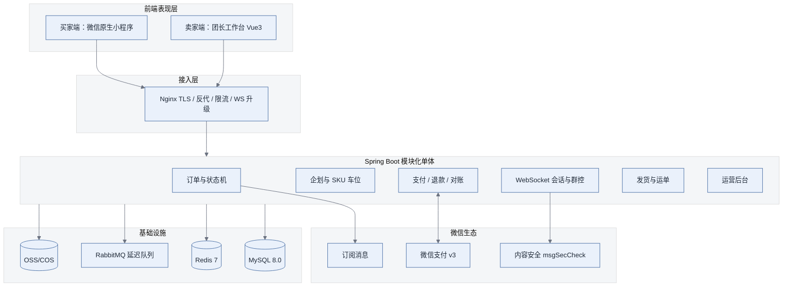
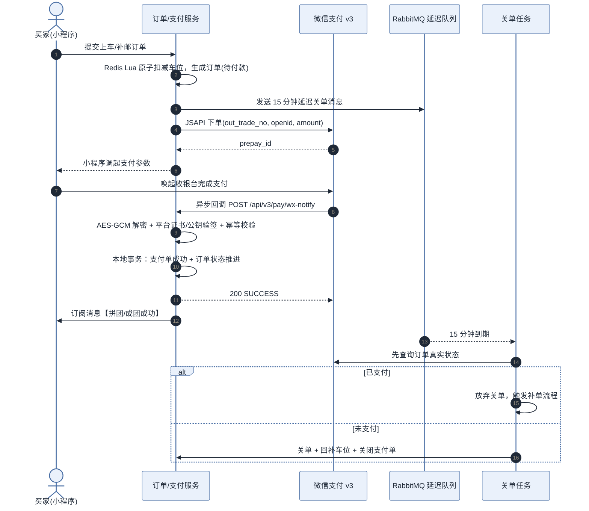
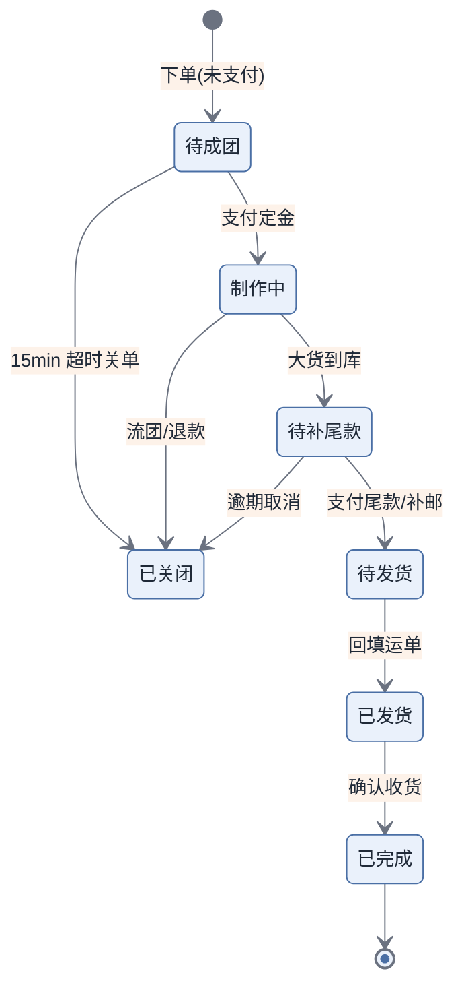

<div align="center">

# 「谷车GO」二次元拼团发车与企划履约平台

**系统设计说明书（v2.0 修订版）**

Java 17 + Spring Boot 3.2 模块化单体 · 微信原生小程序 · 微信支付 API v3<br>
第十八届软件应用开发大赛 · 参赛作品设计说明文档

</div>

| 项目 | 内容 |
| --- | --- |
| 作品名称 | 「谷车GO」——二次元拼团发车与企划履约平台 |
| 参赛赛事 | 第十八届软件应用开发大赛（计算机与信息工程学院软件工程系） |
| 作品类型 | 微信小程序（买家端）+ Web 管理后台（团长端/运营端） |
| 团队信息 | 队长：＿＿＿＿　成员：＿＿＿＿、＿＿＿＿　指导教师：＿＿＿＿ |
| 文档版本 | v2.0（修订版） |
| 修订日期 | 2026-11-11 |
| 文档状态 | 评审稿 —— 待补充团队信息、界面原型图与系统截图 |

---

## 修订记录

| 版本 | 日期 | 修订人 | 修订说明 |
| --- | --- | --- | --- |
| v1.0 | 2026-11-10 | — | 初稿：技术选型、架构、支付时序、功能清单、部分建表语句 |
| v2.0 | 2026-11-11 | — | 按大赛要求与评审要点重构：补充需求分析、订单状态机、结算与合规、非功能、测试、排期、风险等章节；修正支付表述、金额精度、表关联、IM 可靠性等设计缺陷。修订明细见附录 A。 |

---

## 目录

- [阅读说明](#阅读说明)
- [1  项目概述与业务背景](#1--项目概述与业务背景)
  - [1.1  业务痛点分析](#11--业务痛点分析)
  - [1.2  建设目标](#12--建设目标)
  - [1.3  本期范围与非目标](#13--本期范围与非目标)
  - [1.4  合规与资质前提](#14--合规与资质前提)
- [2  需求分析](#2--需求分析)
  - [2.1  角色定义](#21--角色定义)
  - [2.2  核心用例](#22--核心用例)
  - [2.3  需求优先级（MoSCoW）](#23--需求优先级moscow)
  - [2.4  关键业务约束](#24--关键业务约束)
- [3  技术选型与系统架构](#3--技术选型与系统架构)
  - [3.1  技术选型清单](#31--技术选型清单)
  - [3.2  系统拓扑与分层](#32--系统拓扑与分层)
  - [3.3  关键设计决策（ADR）](#33--关键设计决策adr)
- [4  资金流与支付设计](#4--资金流与支付设计)
  - [4.1  支付架构关键原则](#41--支付架构关键原则)
  - [4.2  结算与分账（合规必读）](#42--结算与分账合规必读)
  - [4.3  微信支付业务时序](#43--微信支付业务时序)
  - [4.4  退款设计](#44--退款设计)
  - [4.5  对账](#45--对账)
  - [4.6  模拟支付（演示模式）](#46--模拟支付演示模式)
- [5  功能设计](#5--功能设计)
  - [5.1  买家端（微信小程序）](#51--买家端微信小程序)
  - [5.2  卖家端（团长工作台）](#52--卖家端团长工作台)
  - [5.3  运营后台（新增）](#53--运营后台新增)
  - [5.4  订阅消息策略（修正）](#54--订阅消息策略修正)
- [6  订单状态机](#6--订单状态机)
  - [6.1  状态字段拆分](#61--状态字段拆分)
  - [6.2  关键流转](#62--关键流转)
- [7  数据库设计](#7--数据库设计)
  - [7.1  表清单](#71--表清单)
  - [7.2  核心建表语句](#72--核心建表语句)
  - [7.3  索引与容量规划](#73--索引与容量规划)
- [8  即时通讯与群控](#8--即时通讯与群控)
  - [8.1  通讯链路](#81--通讯链路)
  - [8.2  消息可靠性与离线](#82--消息可靠性与离线)
  - [8.3  群控权限校验（修正示例）](#83--群控权限校验修正示例)
  - [8.4  内容安全](#84--内容安全)
- [9  接口规范](#9--接口规范)
  - [9.1  通用约定（新增）](#91--通用约定新增)
  - [9.2  支付接口](#92--支付接口)
  - [9.3  发货与群控接口](#93--发货与群控接口)
- [10  非功能设计](#10--非功能设计)
  - [10.1  性能指标](#101--性能指标)
  - [10.2  安全设计](#102--安全设计)
  - [10.3  隐私与数据保护](#103--隐私与数据保护)
  - [10.4  可观测与运维](#104--可观测与运维)
- [11  测试与验收](#11--测试与验收)
- [12  项目计划与分工](#12--项目计划与分工)
- [13  风险登记](#13--风险登记)
- [14  创新点与评分对齐](#14--创新点与评分对齐)
- [附录 A  本次修订清单](#附录-a--本次修订清单)
- [附录 B  5 分钟演示视频脚本](#附录-b--5-分钟演示视频脚本)
- [附录 C  交付物清单](#附录-c--交付物清单)

---

## 阅读说明

本文档为参赛作品的系统设计说明书 v2.0 修订版。相对初稿的主要改动包括：拆分订单状态机、补齐结算与合规方案、修正支付与 IM 设计缺陷、新增需求/测试/排期/风险章节；逐条对照见附录 A。

## 1  项目概述与业务背景

### 1.1  业务痛点分析

随着“吃谷”（ACG 角色徽章、立牌等周边）、“抽魔力赏/一番赏”以及“棉花娃娃/Fufu 毛绒公仔企划”的流行，二次元拼团已发展为高频青年消费场景。但目前多依赖“闲鱼转转挂车 + 腾讯文档排单 + QQ 群答疑”，存在以下核心痛点：

1. **资金流脱节与跑单风险**：个人转账易发跑单与卷款跑路风险；定金与尾款/补邮分离，缺乏正规分阶段支付与原路退款闭环。
2. **超长工期与履约信息断层**：Fufu 和大货制作工期动辄 3~6 个月，买家跨学期搬迁频繁，改地址混乱导致错发漏发。
3. **团长排单发货负担沉重**：手工匹配数百条运单号极易错发，缺乏面向二次元按角色/捆单分拣的批量打单工具。
4. **社群沟通分散**：QQ 消息极易被刷屏，团长发出的关键补邮通知和截团公告无法强触达。

### 1.2  建设目标

打造基于 微信小程序 + Java Spring Boot 3.2 模块化单体（单进程、按业务分包，不引入微服务、注册中心与 API 网关） + 单机 WebSocket 长连接（消息落库，预留水平扩展） + 微信支付 V3 的二次元垂直拼团发车与企划履约闭环平台。本期以“在答辩现场能完整跑通一条订单全链路”为第一目标，功能范围按 1.3 裁剪，合规前提按 1.4 明确。

### 1.3  本期范围与非目标

为避免“设计很完整、作品跑不起来”，本期严格按 P0 范围实现，P1 视进度追加，P2 仅作规划说明。

| 范围 | 本期实现（P0） | 本期不实现（P1/P2，仅文档规划） |
| --- | --- | --- |
| 交易 | 企划发车、多 SKU（角色/款式）选位下单、定金 + 尾款/补邮两阶段支付、原路退款 | 优惠券、满减、会员体系、团长分账结算 |
| 履约 | 订单状态机、履约进度节点、三段式改地址、批量发货（Excel 回填）、对账导出 | 电子面单直连快递公司（需企业签约） |
| 社群 | 车队群聊（文字/图片/订单卡片）、@全体、全员/单人禁言、置顶公告 | 语音视频、消息撤回、多端同步 |
| 通知 | 一次性订阅消息、站内红点、团长待办中心 | 短信通道、模板消息群发 |
| 支撑 | 运营后台（资质审核、投诉工单、退款仲裁、数据看板） | 直播带货、社区内容流、多机房部署 |

### 1.4  合规与资质前提

> **⚠ 为什么必须在开发前确认**
>
> 本项目的业务形态涉及支付、抽奖类玩法与用户个人信息，以下四点必须在开发前确认，否则设计再完整也无法上线：

- **主体资质**：微信小程序开通微信支付，需要企业或个体工商户营业执照，个人主体无法开通电商交易类目。开工前必须确认主体；在确认之前，全部支付链路以 4.6 的“模拟支付模式”运行，接口契约与真实支付完全一致，切换仅需改配置。
- **抽赏合规**：在线付费抽赏在监管口径上接近“抽奖”，存在被认定为博彩或变相赌博的风险。本期将“魔力赏”降级为“实物盲盒预售”：公示概率与保底规则、不提供回收/兑换、单用户每日次数上限、未成年人不可参与；功能以开关（feature flag）内置，默认关闭。
- **iOS 虚拟支付**：微信小程序禁止在 iOS 端销售虚拟商品与服务。若抽赏被判为虚拟服务，iOS 端必须屏蔽支付入口，仅保留浏览。
- **个人信息与内容安全**：收件人姓名、手机号、地址属于个人信息，须加密存储与脱敏展示（见 10.3）；群聊属 UGC 场景，须接入微信内容安全接口，否则无法通过小程序审核（见 8.4）。

## 2  需求分析

初稿直接从“技术选型”开始，缺少需求章节。评委按“应用完整程度”打分时，需要先看到需求与角色的界定，因此本章补充。

### 2.1  角色定义

| 角色 | 说明 | 核心诉求 |
| --- | --- | --- |
| 买家 | 参与拼团的二次元消费者，多为学生 | 快速上车、进度透明、地址可改、售后有保障 |
| 团长 | 发起企划的个人或工作室，兼任群主 | 排单效率、批量发货、通知强触达、资金安全 |
| 平台运营 | 平台方 | 资质审核、纠纷仲裁、数据看板 |
| 系统 | 定时任务与回调 | 自动关单、状态推进、对账、通知 |

### 2.2  核心用例

- **买家**：浏览发车大厅 → 查看企划详情与进度 → 选位下单 → 支付定金 → 查看制作进度 → 修改收货地址 → 支付尾款/补邮 → 催发货 → 查看物流 → 申请售后。
- **团长**：创建企划与 SKU → 配置定金比例与补邮规则 → 审核改地址申请 → 导出对账表 → 批量回填运单 → 群公告与禁言 → 处理退款。
- **平台运营**：类目与资质审核 → 处理投诉工单 → 退款仲裁 → 查看经营看板。

### 2.3  需求优先级（MoSCoW）

| 需求 | 优先级 | 说明 |
| --- | --- | --- |
| 下单与车位扣减 | Must | 含并发防超卖，Redis 预扣 + DB 约束兜底 |
| 定金 + 尾款两阶段支付 | Must | 多笔独立支付单，见第 4 章 |
| 订单状态机 | Must | 支付/履约/退款三字段正交，见第 6 章 |
| 三段式地址变更 | Must | 自助 / 审核 / 锁定 |
| 批量发货（Excel 回填） | Must | 团长最高频操作 |
| 订阅消息通知 | Must | 支付成功、发货、补邮提醒 |
| 车队群聊与群控 | Should | 禁言、@全体、公告 |
| 履约进度节点 | Should | 含图片与文字说明 |
| 催发货频控 | Should | 48 小时 1 次 |
| 运营后台 | Should | 答辩时的完整度加分项 |
| 抽赏玩法 | Could | 默认关闭，见 1.4 |
| 分账结算 | Won't（本期） | 以模式 B 规避二清，见 4.2 |

### 2.4  关键业务约束

- 下单后 15 分钟未支付自动关单，并回补车位。
- 定金比例 10%~50%，由团长在企划中配置；尾款 = 总额 − 定金 + 补邮。
- 补邮/尾款支付窗口默认 7 天，逾期进入“待处理”，由团长决定延期或取消。
- **改地址三段式**：制作期自助修改 / 到库包装期需团长审核 / 已出单锁定不可改。
- 一个企划可含多个 SKU，一个订单可含多个 SKU（捆单），库存按 SKU 维度扣减。
- 催发货按订单维度限频，48 小时内仅 1 次。

## 3  技术选型与系统架构

### 3.1  技术选型清单

| 分层 | 技术组件 | 版本与作用 | 本次调整 |
| --- | --- | --- | --- |
| 买家端 | 微信原生小程序 + TDesign Miniprogram | 基础库 3.x；一键登录、微信支付、订阅消息 | 由“原生 / Uni-app 二选一”明确为原生 |
| 卖家端 | Vue3 + TypeScript + Element Plus + Vite | PC 后台，Excel 导入导出、批量操作 | 沿用 |
| 后端核心 | Java 17 + Spring Boot 3.2.x | 模块化单体，开启虚拟线程 | 明确为单体，不拆微服务 |
| 接入层 | Nginx | TLS 终止、静态资源、反向代理、限流 | 移除 Spring Cloud Gateway |
| 持久层 | MyBatis-Plus 3.5.x | ORM、分页插件、乐观锁 | 沿用 |
| 数据存储 | MySQL 8.0 | 单实例 + 每日全备 + binlog | 暂不做主从读写分离 |
| 缓存 | Redis 7.0 + Redisson | 分布式锁、车位预扣、频控、在线路由 | 沿用 |
| 消息队列 | RabbitMQ 3.12 + delayed-message-exchange | 延迟关单、回调解耦、异步通知 | 改用延迟插件，替代 TTL + 死信 |
| 第三方支付 | 微信支付 API v3（JSAPI） | 多笔独立支付单、原路退款 | 补充“微信支付公钥”验签模式 |
| 对象存储 | 阿里云 OSS / 腾讯云 COS | 海报、进度图、面单 PDF；演示可用 MinIO | 沿用 |
| 长连接 | Spring WebSocket + 消息落库 | 群聊/私聊，seq 递增与离线拉取 | 替代 Netty 集群自研 IM |
| 可观测 | Actuator + Prometheus + traceId | 健康检查、指标、链路追踪 | 新增 |

### 3.2  系统拓扑与分层

| 层次 | 组件 | 职责 |
| --- | --- | --- |
| 接入层 | Nginx | TLS、静态资源、反向代理、IP/接口限流、WebSocket 升级 |
| 应用层 | order / project / pay / im / ship / admin 六个包 | 包内 controller-service-mapper 分层，包间只允许 service 接口调用 |
| 领域层 | 状态机、金额计算、车位扣减 | 纯领域逻辑，不依赖框架，可单测 |
| 基础设施 | MySQL / Redis / RabbitMQ / OSS | 数据与中间件，统一通过 adapter 访问 |
| 外部系统 | 微信支付、订阅消息、内容安全 | 出站适配器统一封装，便于 Mock |



*图 3-1  系统拓扑*

### 3.3  关键设计决策（ADR）

| 决策点 | 结论 | 理由 | 被放弃的方案 |
| --- | --- | --- | --- |
| 架构形态 | 模块化单体 | 3 人团队、单机部署即可支撑演示；包边界清晰，后续可平滑拆分 | 微服务 + 注册中心 + 网关 |
| 前端框架 | 微信原生小程序 | 支付、订阅消息、内容安全接入链路最短，少一层构建与适配 | Uni-app（Vue3） |
| IM 方案 | 单机 WebSocket + 落库 | 演示规模下单机足够；保证消息不丢比追求集群更重要 | Netty 集群 + Redis Pub/Sub |
| 延迟关单 | RabbitMQ 延迟插件 | 规避消息级 TTL 的队头阻塞问题 | TTL + 死信队列 |
| 金额单位 | BIGINT 存“分” | 完全避免浮点与四舍五入误差，对账精确 | DECIMAL(10,2) 存“元” |
| 分库分表 | 不做 | 3 年约 500 万行，单表加索引即可承载 | ShardingSphere 分表 |
| 结算模式 | 团长独立商户号（模式 B） | 平台不触碰资金，规避“二清”合规风险 | 平台代收 + 分账（模式 A） |

## 4  资金流与支付设计

二次元吃谷区别于普通电商的核心在于：定金（预售阶段）+ 尾款/补邮（大货到库阶段）的跨月甚至跨季度长周期结算模式。

### 4.1  支付架构关键原则

1. **一笔业务订单对应多笔独立支付单**：主订单（t_order）挂载多条支付流水（t_payment_record），定金、尾款、补邮各自生成独立的 out_trade_no。微信支付不支持对同一商户订单号多次扣款，因此“分阶段支付”必须实现为多笔独立支付单，而不是对同一单重复调用支付接口。
2. **签名与验签**：商户使用商户私钥对请求签名；验签时使用微信平台证书或微信支付公钥；回调报文使用 APIv3 密钥做 AES-256-GCM 解密。2024 年起新入驻商户默认采用“微信支付公钥”模式，存量商户仍可使用平台证书，代码需同时支持两种模式并通过配置切换。
3. **回调幂等**：Redis 排他锁 + 支付单状态机（仅允许“待支付 → 成功”一次流转）+ 数据库唯一索引三重兜底。
4. **原路退款**：按支付流水逐笔退款，支持部分退款；退款金额不得超过该笔实付金额。

### 4.2  结算与分账（合规必读）

> **⚠ 合规红线：二清**
>
> 平台代收货款后再转付给团长，在未取得支付牌照的情况下即构成“二清”，属于违规经营，也是本类产品最常见的法律风险。上线前必须在下列三种模式中确定一种，并在企划协议中写明。

| 模式 | 资金路径 | 合规要点 | 适用场景 |
| --- | --- | --- | --- |
| A 服务商分账 | 买家 → 平台特约商户 → 按比例分账至团长子商户 | 平台需以服务商身份接入，团长作为特约商户进件；分账比例、冻结期、分账回退须约定 | 平台化规模运营 |
| B 独立收款（本期采用） | 买家 → 团长自己的商户号；平台不触碰资金 | 平台仅提供 SaaS 工具并收取软件服务费，无二清风险 | 参赛演示与早期运营 |
| C 模拟支付 | 无真实资金流转 | 仅记录账务流水，用于功能演示 | 尚无商户资质时 |

本文以模式 B 为主线设计，模式 A 的差异点已在 t_settlement 表中预留字段（settle_mode、wx_batch_id）；模式 C 的实现见 4.6。

### 4.3  微信支付业务时序



*图 4-1  支付与关单时序（新增“关单前查单”以消除与回调的竞态）*

### 4.4  退款设计

- **流程**：买家申请 / 团长发起 → 平台仲裁（小额可自动通过）→ 调用退款接口 → 退款回调 → 更新支付单与订单状态。
- **多阶段订单按流水逐笔退款**：已付定金未付尾款时只退定金；已付尾款则两笔分别退。
- 退款失败重试 3 次（指数退避）后转人工工单，并记录 t_refund_record.retry_count。
- **车位回补规则**：未排单可回补；已进入制作阶段默认不回补，由团长在企划中配置。

### 4.5  对账

每日 02:00 下载微信交易账单与资金账单，与 t_payment_record 按 out_trade_no 逐笔比对；金额、状态不一致的记录写入差异表 t_recon_diff 并触发告警，由运营在后台处理。对账是“资金安全”这一卖点唯一可验证的证据，不可省略。

### 4.6  模拟支付（演示模式）

通过配置 pay.channel=mock 启用：预支付接口返回本地收银台地址，前端点击“模拟支付成功”后，直接触发与真实回调完全相同的处理链路（同一套幂等逻辑与状态机）。真实支付与模拟支付共用 PayGateway 接口，切换只改配置、不改业务代码，保证无商户资质时仍可完整演示。

## 5  功能设计

### 5.1  买家端（微信小程序）

| 模块 | 功能点 | 说明 |
| --- | --- | --- |
| 发车大厅 | 预售拼谷选位、企划检索、进度概览 | 原“魔力赏抽赏池”改为“实物盲盒预售”，默认关闭 |
| 订单中心 | 订单号/关键词/手机号检索；全生命周期跟踪 | 状态按“支付状态 + 履约阶段”两组呈现，避免单字段歧义 |
| 地址管理 | 三段式变更、历史版本、锁定提示 | 制作期自助 / 到库期需审核 / 出单后锁定 |
| 催发货 | 48 小时 1 次，写入团长待办中心 | 取消“智能”表述，实为频控 + 待办聚合 |
| 即时通讯 | 订单卡片、图片、文字；群置顶公告与 @全体红点 | 见第 8 章 |
| 通知 | 支付成功、发货、补邮提醒 | 一次性订阅 + 订阅次数管理，见 5.4 |

#### 5.1.1  三阶地址安全变更

1. **大货前（工期内）**：支持一键调用微信原生地图/微信通讯录地址无感自动同步修改，保存历史版本。
2. **到库包装中**：前端提示需人工审核，买家填写搬家/换校区说明后提交，团长 PC 端一键批准或拒绝。
3. **打单已发货**：锁定界面不可修改，并显示顺丰/中通实时物流路由轨迹。

### 5.2  卖家端（团长工作台）

- **订单整理与高级检索**：按企划、角色/款式、发货状态筛选，支持“被催单中”“待审核改地址”专项标记；一键导出对账 Excel。
- **批量发货【核心】**：模式一（Excel 反向导入回填：订单号-快递公司-运单号）为本期默认路径；模式二（电子面单直连）需企业资质与快递公司签约，作为规划功能，代码保留 ExpressAdapter 接口，便于后续接入快递鸟/快递 100。
- **发货异常标记**：地址错误、偏远地区可单条置为“发货受阻”，并自动私信买家。
- **车队群控**：@全体、全员/单人禁言、发布与修改置顶公告；所有群控操作写入审计日志 t_im_group_op_log，可追溯。

### 5.3  运营后台（新增）

初稿只设计了买卖两端，缺少平台侧。补一个轻量运营后台，用于答辩时体现“平台”角色：

- **资质与类目审核**：团长入驻、企划上线审批。
- **投诉与工单**：群聊举报、履约超时、退款纠纷。
- **退款仲裁**：金额与责任判定，联动 4.4 退款流程。
- **经营看板**：GMV、履约时效、催单率、纠纷率、退款率。

### 5.4  订阅消息策略（修正）

初稿写“长期订阅消息”是不成立的：普通小程序只能使用一次性订阅消息，用户每授权一次仅可下发一条；长期订阅仅对政务、医疗等特定类目开放。因此策略调整为：

- 在支付成功、改地址提交、确认收货等关键节点引导用户勾选订阅。
- 每次授权计入 t_notify_subscribe 的可用次数；下发前校验并扣减，次数不足时降级为站内红点。
- 团长侧通知走“运营消息 + 待办中心”，不依赖订阅消息，避免打扰其私人微信。

## 6  订单状态机

> **⚠ 设计问题：一个字段表达不了两件事**
>
> 初稿用单一 order_status 同时表达支付与履约（如“20 已付定金/制作中”），一旦出现“制作中但已退款”“已发货但只付了定金”就无法表达。本章将其拆为三个正交字段。

### 6.1  状态字段拆分

| 字段 | 取值 | 说明 |
| --- | --- | --- |
| pay_status | 0 未支付 / 10 定金已付 / 20 尾款已付（结清）/ 30 部分退款 / 40 全额退款 | 只管钱 |
| stage_status | 0 待成团 / 10 制作中 / 20 待补尾款 / 30 待发货 / 40 已发货 / 50 已完成 / 90 已关闭 | 只管货 |
| refund_status | 0 无 / 10 申请中 / 20 已退款 / 30 已拒绝 | 只管售后 |

### 6.2  关键流转

| 当前阶段 | 事件 | 目标阶段 | 触发方 | 约束 |
| --- | --- | --- | --- | --- |
| 0 待成团 | 支付定金成功 | 10 制作中 | 支付回调 | pay_status 置 10 |
| 10 制作中 | 团长标记大货到库 | 20 待补尾款 | 团长 | 生成尾款支付单 |
| 20 待补尾款 | 支付尾款/补邮成功 | 30 待发货 | 支付回调 | pay_status 置 20 |
| 30 待发货 | 回填运单号 | 40 已发货 | 团长批处理 | 写 t_shipment，地址锁定 |
| 40 已发货 | 买家确认收货 | 50 已完成 | 买家/超时自动 | 7 天自动确认 |
| 任意未发货 | 退款成功 | 90 已关闭 | 支付回调 | 回补车位（按规则） |
| 0 待成团 | 15 分钟未支付 | 90 已关闭 | 延迟队列 | 关单前必须先查单 |



*图 6-1  履约阶段状态机（支付与退款状态独立维护，不参与本图）*

## 7  数据库设计

### 7.1  表清单

| 表名 | 说明 | 本次变化 |
| --- | --- | --- |
| t_user | 用户（买家/团长/运营） | 新增 |
| t_group_project | 企划（发车项目） | 补齐 DDL |
| t_project_sku | 企划 SKU（角色/款式）与库存 | 新增 |
| t_project_progress | 履约进度节点 | 新增 |
| t_order | 订单主表 | 重构字段与索引 |
| t_order_item | 订单明细（捆单） | 补齐 DDL |
| t_payment_record | 支付流水（多笔） | 改 order_id 关联、金额存分 |
| t_refund_record | 退款流水 | 新增 |
| t_settlement | 结算记录 | 新增 |
| t_shipment | 发货与运单 | 新增（从 t_order 拆出） |
| t_address_change_log | 地址变更申请 | 结构化存证 |
| t_rush_ship_log | 催发货审计与频控 | 沿用 |
| t_im_group / _member / _message | 群、成员、消息 | 补 t_im_message |
| t_im_group_op_log | 群控操作审计 | 新增 |
| t_notify_subscribe | 订阅消息次数 | 新增 |
| t_recon_diff | 对账差异 | 新增 |

### 7.2  核心建表语句

#### 7.2.1  订单主表 t_order

```
CREATE TABLE `t_order` (
  `order_id`      BIGINT UNSIGNED NOT NULL AUTO_INCREMENT COMMENT '内部主键',
  `order_sn`      VARCHAR(32)  NOT NULL COMMENT '对外订单号 GC+yyyyMMdd+6位随机',
  `user_id`       BIGINT UNSIGNED NOT NULL COMMENT '买家ID',
  `project_id`    BIGINT UNSIGNED NOT NULL COMMENT '企划ID',
  `seller_id`     BIGINT UNSIGNED NOT NULL COMMENT '团长ID（冗余，避免多表join）',
  `pay_status`    TINYINT NOT NULL DEFAULT 0 COMMENT '0未支付 10定金已付 20尾款已付 30部分退款 40全额退款',
  `stage_status`  TINYINT NOT NULL DEFAULT 0 COMMENT '0待成团 10制作中 20待补尾款 30待发货 40已发货 50已完成 90已关闭',
  `refund_status` TINYINT NOT NULL DEFAULT 0 COMMENT '0无 10申请中 20已退款 30已拒绝',
  `total_amount`  BIGINT NOT NULL DEFAULT 0 COMMENT '订单总额（分）',
  `deposit_amount` BIGINT NOT NULL DEFAULT 0 COMMENT '定金（分）',
  `balance_amount` BIGINT NOT NULL DEFAULT 0 COMMENT '尾款（分）',
  `postage_amount` BIGINT NOT NULL DEFAULT 0 COMMENT '补邮（分）',
  `paid_amount`   BIGINT NOT NULL DEFAULT 0 COMMENT '累计实付（分）',
  `receiver_name`    VARCHAR(64)  NOT NULL COMMENT '收件人（AES-GCM 密文）',
  `receiver_phone`   VARCHAR(128) NOT NULL COMMENT '手机号（AES-GCM 密文）',
  `receiver_province` VARCHAR(32) NOT NULL COMMENT '省份',
  `receiver_city`     VARCHAR(32) NOT NULL COMMENT '城市',
  `receiver_district` VARCHAR(32) NOT NULL COMMENT '区县',
  `receiver_detail`   VARCHAR(512) NOT NULL COMMENT '详细地址（AES-GCM 密文）',
  `address_locked` TINYINT(1) NOT NULL DEFAULT 0 COMMENT '出单后锁定',
  `remark`        VARCHAR(255) DEFAULT NULL COMMENT '买家留言',
  `version`       INT NOT NULL DEFAULT 0 COMMENT '乐观锁',
  `is_deleted`    TINYINT(1) NOT NULL DEFAULT 0 COMMENT '逻辑删除',
  `created_at`    DATETIME NOT NULL DEFAULT CURRENT_TIMESTAMP,
  `updated_at`    DATETIME NOT NULL DEFAULT CURRENT_TIMESTAMP ON UPDATE CURRENT_TIMESTAMP,
  PRIMARY KEY (`order_id`),
  UNIQUE KEY `uniq_order_sn` (`order_sn`),
  KEY `idx_user_status` (`user_id`, `stage_status`, `created_at`),
  KEY `idx_project_status` (`project_id`, `stage_status`, `created_at`),
  KEY `idx_seller_status` (`seller_id`, `stage_status`)
) ENGINE=InnoDB DEFAULT CHARSET=utf8mb4 COMMENT='订单主表';
```

#### 7.2.2  支付流水 t_payment_record

```
CREATE TABLE `t_payment_record` (
  `pay_id`      BIGINT UNSIGNED NOT NULL AUTO_INCREMENT,
  `out_trade_no` VARCHAR(64) NOT NULL COMMENT '商户支付单号 = order_sn+阶段+序号',
  `order_id`    BIGINT UNSIGNED NOT NULL COMMENT '关联订单主键（原用 order_sn）',
  `user_id`     BIGINT UNSIGNED NOT NULL,
  `pay_stage`   TINYINT NOT NULL COMMENT '1定金 2尾款 3补邮',
  `amount`      BIGINT NOT NULL COMMENT '实付金额（分）',
  `channel`     VARCHAR(16) NOT NULL DEFAULT 'wxpay' COMMENT 'wxpay/mock',
  `wx_transaction_id` VARCHAR(64) DEFAULT NULL COMMENT '微信订单号',
  `pay_status`  TINYINT NOT NULL DEFAULT 0 COMMENT '0待支付 1成功 2已退款 3已关闭',
  `payer_openid` VARCHAR(64) NOT NULL,
  `pay_success_time` DATETIME DEFAULT NULL,
  `created_at`  DATETIME NOT NULL DEFAULT CURRENT_TIMESTAMP,
  PRIMARY KEY (`pay_id`),
  UNIQUE KEY `uniq_out_trade_no` (`out_trade_no`),
  UNIQUE KEY `uniq_wx_tx` (`wx_transaction_id`),
  KEY `idx_order` (`order_id`)
) ENGINE=InnoDB DEFAULT CHARSET=utf8mb4 COMMENT='微信支付流水（一单多笔）';
```

#### 7.2.3  退款流水 t_refund_record

```
CREATE TABLE `t_refund_record` (
  `refund_id`   BIGINT UNSIGNED NOT NULL AUTO_INCREMENT,
  `out_refund_no` VARCHAR(64) NOT NULL COMMENT '商户退款单号',
  `pay_id`      BIGINT UNSIGNED NOT NULL COMMENT '关联支付流水',
  `order_id`    BIGINT UNSIGNED NOT NULL,
  `refund_amount` BIGINT NOT NULL COMMENT '退款金额（分）',
  `reason`      VARCHAR(128) DEFAULT NULL,
  `audit_status`  TINYINT NOT NULL DEFAULT 0 COMMENT '0待审 1通过 2拒绝',
  `refund_status` TINYINT NOT NULL DEFAULT 0 COMMENT '0处理中 1成功 2失败',
  `wx_refund_id`  VARCHAR(64) DEFAULT NULL,
  `retry_count`   TINYINT NOT NULL DEFAULT 0,
  `created_at`  DATETIME NOT NULL DEFAULT CURRENT_TIMESTAMP,
  PRIMARY KEY (`refund_id`),
  UNIQUE KEY `uniq_out_refund_no` (`out_refund_no`),
  KEY `idx_pay` (`pay_id`)
) ENGINE=InnoDB DEFAULT CHARSET=utf8mb4 COMMENT='退款流水';
```

#### 7.2.4  SKU 与库存 t_project_sku

```
CREATE TABLE `t_project_sku` (
  `sku_id`       BIGINT UNSIGNED NOT NULL AUTO_INCREMENT,
  `project_id`   BIGINT UNSIGNED NOT NULL,
  `sku_name`     VARCHAR(64) NOT NULL COMMENT '角色/款式',
  `unit_price`   BIGINT NOT NULL COMMENT '单价（分）',
  `deposit_ratio` TINYINT NOT NULL DEFAULT 30 COMMENT '定金比例 %',
  `stock_total`  INT NOT NULL DEFAULT 0,
  `stock_locked` INT NOT NULL DEFAULT 0 COMMENT '已锁未付',
  `stock_sold`   INT NOT NULL DEFAULT 0,
  `version`      INT NOT NULL DEFAULT 0,
  PRIMARY KEY (`sku_id`),
  UNIQUE KEY `uniq_proj_name` (`project_id`, `sku_name`),
  KEY `idx_proj` (`project_id`),
  CONSTRAINT `chk_stock` CHECK (`stock_locked` + `stock_sold` <= `stock_total`)
) ENGINE=InnoDB DEFAULT CHARSET=utf8mb4 COMMENT='企划SKU与库存（DB 层兜底防超卖）';
```

#### 7.2.5  群消息 t_im_message

```
CREATE TABLE `t_im_message` (
  `msg_id`      BIGINT UNSIGNED NOT NULL AUTO_INCREMENT COMMENT '服务端自增，兼作全局游标',
  `client_msg_id` VARCHAR(64) NOT NULL COMMENT '客户端幂等ID',
  `conv_id`     VARCHAR(64) NOT NULL COMMENT '会话ID：g_{groupId} 或 p_{小userId}_{大userId}',
  `from_user_id` BIGINT UNSIGNED NOT NULL,
  `msg_type`    TINYINT NOT NULL COMMENT '1文本 2图片 3订单卡片 4系统通知',
  `content`     TEXT NOT NULL COMMENT '文本或JSON',
  `seq`         BIGINT NOT NULL COMMENT '会话内递增序号',
  `status`      TINYINT NOT NULL DEFAULT 0 COMMENT '0正常 1撤回 2拦截',
  `created_at`  DATETIME(3) NOT NULL DEFAULT CURRENT_TIMESTAMP(3),
  PRIMARY KEY (`msg_id`),
  UNIQUE KEY `uniq_client_msg` (`from_user_id`, `client_msg_id`),
  UNIQUE KEY `uniq_conv_seq` (`conv_id`, `seq`),
  KEY `idx_conv` (`conv_id`, `msg_id`)
) ENGINE=InnoDB DEFAULT CHARSET=utf8mb4 COMMENT='IM消息（先落库后推送）';
```

#### 7.2.6  结算 t_settlement

```
CREATE TABLE `t_settlement` (
  `settle_id`    BIGINT UNSIGNED NOT NULL AUTO_INCREMENT,
  `order_id`     BIGINT UNSIGNED NOT NULL,
  `seller_id`    BIGINT UNSIGNED NOT NULL,
  `settle_mode`  VARCHAR(16) NOT NULL COMMENT 'DIRECT(模式B)/SHARE(模式A)/MOCK',
  `gross_amount` BIGINT NOT NULL,
  `platform_fee` BIGINT NOT NULL DEFAULT 0,
  `net_amount`   BIGINT NOT NULL,
  `wx_batch_id`  VARCHAR(64) DEFAULT NULL COMMENT '分账单号（模式A）',
  `settle_status` TINYINT NOT NULL DEFAULT 0 COMMENT '0待结算 1已结算 2失败 3冻结',
  `settle_time`  DATETIME DEFAULT NULL,
  PRIMARY KEY (`settle_id`),
  UNIQUE KEY `uniq_order` (`order_id`)
) ENGINE=InnoDB DEFAULT CHARSET=utf8mb4 COMMENT='结算/分账记录';
```

其余表（t_user、t_group_project、t_project_progress、t_order_item、t_shipment、t_im_group 等）按同一规范编写：主键 BIGINT UNSIGNED 自增、金额一律 BIGINT 分、外键一律用主键 ID 而非业务号、每表带 created_at/updated_at 与必要的联合索引。完整 DDL 见项目仓库 db/schema.sql。

### 7.3  索引与容量规划

- **索引原则**：以“等值 + 范围”顺序建联合索引，最左前缀；区分度低的字段（如 status）不单独建索引；避免在索引列上做函数运算。
- **容量估算**：按日订单 5,000、3 年计约 500 万行，单表可承载，不引入分库分表；单表超过 2000 万行再考虑按 project_id 归档。
- 慢 SQL 阈值 200ms，开启慢查询日志并接入告警；金额字段禁止使用 FLOAT/DOUBLE。
- **备份**：每日 02:30 全量备份保留 7 天，binlog 保留 7 天，季度做一次恢复演练。

## 8  即时通讯与群控

### 8.1  通讯链路

- 买家端使用小程序原生 wx.connectSocket 建立 WSS 长连接；需在微信后台配置 socket 合法域名（必须为已备案的 https/wss 域名），否则真机无法连接。
- 服务端为 Spring WebSocket，Nginx 负责 Upgrade 透传与连接数限流；单机维护 userId → Session 映射。
- 跨实例扩展预留 Redis 路由表，当前单机部署不启用。

### 8.2  消息可靠性与离线

> **⚠ 设计问题：在线不等于可达**
>
> 初稿仅用 ConcurrentHashMap + Redis Pub/Sub，只覆盖“双方在线且订阅未断”的场景；Pub/Sub 不保证可达，订阅者掉线消息即永久丢失。补充如下机制：

- **先落库后推送**：消息写入 t_im_message 成功后再推送，失败不推送。
- **离线拉取**：客户端重连后按 conv_id + seq 增量拉取未读。
- **幂等**：client_msg_id 唯一索引，重复提交直接返回已存在消息。
- **顺序**：同一会话 seq 单调递增，客户端按 seq 排序渲染。
- **心跳与重连**：30s ping/pong，60s 无响应断开并指数退避重连。
- **多端在线**：同一用户允许多个 Session，推送时遍历。

### 8.3  群控权限校验（修正示例）

初稿示例存在编译错误：handleGroupMsg 中直接使用了 channelRead0 的局部参数 ctx，超出作用域；switch 也缺少 default 分支。修正后的核心逻辑如下。

```
public class GroupChatHandler extends SimpleChannelInboundHandler<TextWebSocketFrame> {

    @Override
    protected void channelRead0(ChannelHandlerContext ctx, TextWebSocketFrame frame) {
        ImPacket packet;
        try {
            packet = JsonUtils.parse(frame.text(), ImPacket.class);
        } catch (Exception e) {
            writeError(ctx, "非法报文");
            return;
        }
        Long senderId = ctx.channel().attr(USER_ID_KEY).get();
        if (senderId == null) { ctx.close(); return; }

        switch (packet.getAction()) {
            case SEND_MSG:
                handleGroupMsg(ctx, senderId, packet);   // 关键：ctx 显式传入
                break;
            case MUTE_ALL:
            case UNMUTE_ALL:
            case MUTE_USER:
            case PUBLISH_NOTICE:
                if (!groupService.isOwner(packet.getGroupId(), senderId)) {
                    writeError(ctx, "无权限");
                    return;
                }
                executeGroupControl(senderId, packet);
                groupOpLogService.log(senderId, packet);  // 审计留痕
                break;
            default:
                writeError(ctx, "不支持的操作");
        }
    }

    private void handleGroupMsg(ChannelHandlerContext ctx, Long senderId, ImPacket packet) {
        Long groupId = packet.getGroupId();
        if (groupId == null || !groupMemberService.isMember(groupId, senderId)) {
            writeError(ctx, "你不在该群");
            return;
        }
        if (groupService.isAllMuted(groupId) && !groupService.isOwner(groupId, senderId)) {
            writeError(ctx, "当前群已开启全员禁言，仅团长可发言");
            return;
        }
        if (groupService.isUserMuted(groupId, senderId)) {
            writeError(ctx, "您已被禁言，暂无法发言");
            return;
        }
        if (contentSecurityService.hit(packet.getContent())) {
            writeError(ctx, "内容不合规");
            return;
        }
        imMessageService.saveAndBroadcast(packet);   // 先落库再广播
    }

    private void writeError(ChannelHandlerContext ctx, String msg) {
        ctx.channel().writeAndFlush(new TextWebSocketFrame(Response.fail(msg)));
    }
}
```

注意：PC 端 REST 接口（如 /api/v1/seller/group/control）同样必须做归属校验——不能只信任请求体里的 groupId，否则存在越权（IDOR）风险；所有按 ID 访问的资源都要校验“当前登录用户是否拥有该资源”。

### 8.4  内容安全

- **文本**：调用微信 msgSecCheck 同步检测；本地再用 DFA 敏感词表做前置过滤，降低接口耗时。
- **图片**：调用 mediaCheckAsync 异步回调，未通过则撤回并通知发送者。
- **处置**：命中即拦截并记录；同一用户 24 小时内 3 次违规自动禁言 24 小时。

## 9  接口规范

### 9.1  通用约定（新增）

- **统一响应体**：{ code, msg, data, traceId }，业务错误码分段（1xxxx 通用、2xxxx 订单、3xxxx 支付、4xxxx 社群）。
- **鉴权**：Authorization: Bearer <JWT>，accessToken 2 小时、refreshToken 7 天。
- **幂等**：写接口可携带 Idempotency-Key，服务端落表去重。
- 回调接口 /api/v3/pay/wx-notify 必须在安全配置中放行且不校验 JWT，仅校验微信签名；否则回调全部 401，订单永远不会变成已支付——这是新手最常见的线上事故。
- 分页统一 page/size，默认 1/20，最大 100。

### 9.2  支付接口

```
POST /api/v1/pay/wx-prepay
请求: { "orderSn": "GC20261109001", "payStage": 1 }   // 1定金 2尾款 3补邮

响应: {
  "code": 200,
  "data": {
    "timeStamp": "1731140000",
    "nonceStr": "5K8264ILTKCH16CQ2502SI8ZNMTM67VS",
    "package": "prepay_id=wx20261109160000abc123456",
    "signType": "RSA",
    "paySign": "oWxtfG...Base64Signature..."
  }
}
```

注意：小程序 wx.requestPayment 的参数名是 package，不是 packageVal（初稿此处字段名错误，直接导致调起支付失败）。

### 9.3  发货与群控接口

```
POST /api/v1/seller/orders/batch-ship
{ "projectId": 1001,
  "shipments": [ { "orderSn": "GC20261109001", "company": "SF", "trackingNo": "SF100010001" } ] }
// 响应: { updated: 1, failed: [ { "orderSn": "...", "reason": "地址已锁定" } ] }

POST /api/v1/seller/group/control
{ "groupId": 8801,
  "actionType": "MUTE_ALL",        // MUTE_ALL / UNMUTE_ALL / MUTE_USER / PUBLISH_NOTICE
  "targetUserId": null,
  "content": "各位车友，大货已发顺丰特快，请前往订单中心核对单号！" }
```

## 10  非功能设计

### 10.1  性能指标

| 指标 | 目标值 | 验证方式 |
| --- | --- | --- |
| 下单接口 P95 | ≤ 300ms（50 并发） | JMeter 压测 |
| 订单查询 P95 | ≤ 150ms | JMeter |
| 支付回调处理 | ≤ 200ms，成功率 100% | 回调压测 + 日志统计 |
| 群聊推送 | 1 万在线，单群 500 人，P95 ≤ 500ms | 模拟客户端脚本 |
| 可用性 | 99.5%（演示期） | Actuator 健康检查 |

### 10.2  安全设计

- **越权防护**：所有资源查询强制附加 user_id / seller_id 条件；管理端接口独立鉴权注解。
- **防重放**：回调与敏感接口校验时间戳（±5 分钟）+ nonce 去重。
- **限流**：Nginx limit_req + Redis 计数，重点保护登录、下单、催单接口。
- **密钥管理**：微信商户私钥、APIv3 密钥仅存环境变量/密钥管理服务，禁止入库、禁止提交到 Git。
- **注入与 XSS**：MyBatis 使用 #{}，前端输出转义，富文本白名单过滤。

### 10.3  隐私与数据保护

- **字段级加密**：姓名、手机号、详细地址使用 AES-256-GCM 加密存储，密钥轮换保留旧密钥版本。
- 脱敏展示：列表页手机号显示 138****8888，地址仅显示到区县；完整信息需二次鉴权查看。
- **导出管控**：导出对账单加水印与操作人记录，文件 7 天后自动清理。
- **注销与删除**：支持账号注销，按法规保留交易记录后删除个人信息。

### 10.4  可观测与运维

- **全链路 traceId**：网关生成，透传至 MQ 与异步任务，日志统一输出。
- **关键告警**：5xx 比例 > 1%、支付回调失败、MQ 积压 > 1000、慢 SQL > 200ms。
- **部署**：Docker Compose 单机（nginx / app / mysql / redis / rabbitmq），4C8G 即可。
- **发布与回滚**：镜像 tag 版本化，保留上一版本，异常时一条命令回滚。

## 11  测试与验收

| 类型 | 范围 | 工具 | 通过标准 |
| --- | --- | --- | --- |
| 单元测试 | 状态机流转、金额计算、车位扣减 | JUnit5 + Mockito | 行覆盖率 ≥ 70% |
| 集成测试 | 支付回调、关单、退款 | Testcontainers | 全部通过 |
| 接口测试 | 全部 REST 接口 | Apifox | 全部通过 |
| 性能测试 | 下单、查询、回调 | JMeter | P95 达标且无错误 |
| 安全测试 | 越权、注入、重放 | 人工 + 脚本 | 无高危问题 |
| 验收测试 | 附录 B 演示脚本 | 人工走查 | 全流程通过 |

## 12  项目计划与分工

按 3 人团队、3 周（11/11 – 12/01）排期，与 1.3 的 P0 范围对应；若截止时间更早，按“交易 → 发货 → 社群 → 后台”的顺序继续裁剪。

| 周次 | 时间 | 交付物 | 分工 |
| --- | --- | --- | --- |
| W1 | 11/11–11/17 | 需求与原型定稿、ER 与接口文档、项目骨架、登录与企划列表 | 全员：A 后端骨架、B 数据库与接口、C 原型与小程序框架 |
| W2 | 11/18–11/24 | 下单/支付（Mock+真实）/状态机/改地址/发货/群聊 | A 订单与支付、B IM 与发货、C 两端页面 |
| W3 | 11/25–12/01 | 联调、演示数据、压测、PPT、视频、文档定稿 | 全员：联合调试，C 主导 PPT 与视频 |

## 13  风险登记

| 风险 | 影响 | 概率 | 应对措施 |
| --- | --- | --- | --- |
| 无企业主体 / 商户号 | 高 | 高 | 立即确认；默认启用模拟支付（4.6） |
| 抽赏玩法合规被拒 | 高 | 中 | 降级为实物盲盒并公示概率，或直接关闭 |
| 电子面单无法签约 | 中 | 高 | 以 Excel 回填为默认路径 |
| 三周工期不足 | 高 | 中 | 严格按 P0 范围，逐周验收 |
| 小程序审核周期 | 中 | 中 | 提前 2 周提交审核，准备体验版演示 |
| 演示现场网络异常 | 高 | 中 | 本地 Mock + 录屏兜底 |

## 14  创新点与评分对齐

| 评审维度 | 对应的设计 | 可验证的证据 |
| --- | --- | --- |
| 技术难度 | 多阶段支付的账务一致性（多支付单 + 三字段状态机 + 幂等 + 对账）；车位扣减 Redis 预扣与 DB 约束双重防超卖；IM 的 seq + ack + 落库可靠投递 | 单元测试与压测报告 |
| 应用完整度 | 买家端 + 团长端 + 运营端三端闭环，一条订单可从下单走到完成 | 演示视频与现场演示 |
| 用户体验 | 履约雷达、三段式改地址、催单待办聚合、订阅消息强提醒 | 原型图与可用性走查 |
| 创意创新 | 把“订单”与“车队群聊”双向绑定（消息可挂订单卡片、群公告随履约阶段自动同步）；把“长工期”作为一等公民设计（进度节点、地址生命周期、补邮窗口） | 功能演示 + 交互稿 |
| 市场价值 | 补充目标用户规模与调研数据，明确商业模式（SaaS 订阅 / 交易服务费），避免只讲痛点 | 调研问卷与访谈记录 |

说明：初稿使用“首创”“颠覆”等表述，容易被质疑；本版改为可被验证的组合式创新描述，更符合评审口径。

---

## 附录 A  本次修订清单

| # | 位置 | 原稿问题 | 处理 |
| --- | --- | --- | --- |
| 1 | §2.1 | “模块化单体”却引入 Spring Cloud Gateway，架构自相矛盾 | 删除网关，明确单体 |
| 2 | §2.1 | “微信原生框架 / Uni-app”未二选一 | 定为微信原生小程序 |
| 3 | §2.1 | “分阶段多次扣费”与微信支付能力不符 | 改为多笔独立支付单 |
| 4 | §2.1 | “动态多条件分表查询”与不分表矛盾 | 删除该表述 |
| 5 | §3.1 | 只写平台证书，未覆盖微信支付公钥 | 补充双模式兼容 |
| 6 | §3.1 | “双向加签验签”表述错误 | 改为商户私钥签名 + 平台证书/公钥验签 |
| 7 | §3.2 | 未处理关单与支付回调的竞态 | 关单前查单 + 幂等表 |
| 8 | 新增 4.2 | 完全缺失团长结算，存在二清风险 | 补三种结算模式 |
| 9 | 新增 4.5 | 写了“对账中心”但无设计 | 补对账流程 |
| 10 | §4.1 | “48h 智能防骚扰”名不副实 | 改为频控 + 待办聚合 |
| 11 | §4.1 | “长期订阅消息”普通小程序不成立 | 改为一次性订阅 + 次数管理 |
| 12 | §4.2 | 电子面单直连对参赛团队不可行 | 降级为 Excel 回填优先 |
| 13 | §5 | order_status 单字段耦合支付与履约 | 拆三字段 + 状态机 |
| 14 | §5 | 子表用 order_sn 关联，性能与一致性差 | 统一 order_id |
| 15 | §5 | 金额 DECIMAL 存元 | 改 BIGINT 存分 |
| 16 | §5 | ER 图有表但无 DDL（t_user 等） | 补齐 6 张核心表 + 表清单 |
| 17 | §5 | 缺退款/结算/SKU/进度/消息表 | 新增 |
| 18 | §5 | t_im_group UNIQUE(project_id)，一企划只能一群 | 去掉该唯一约束 |
| 19 | §6 | 内存 Map + Pub/Sub 无离线消息 | 落库 + seq + 增量拉取 |
| 20 | §6 | 示例代码 ctx 越作用域、switch 无 default | 修正为可编译版本 |
| 21 | §6 | 无内容安全设计 | 新增 8.4 |
| 22 | §7 | 未说明回调接口的放行与验签 | 补充 9.1 |
| 23 | §7 | 响应字段 packageVal 错误 | 改为 package |
| 24 | §8 | “首创/颠覆”表述易被质疑 | 改为可验证的组合创新 |
| 25 | 全文 | 缺需求、测试、排期、风险、合规章节 | 新增第 2/10/11/12/13 章与 1.3/1.4 |

---

## 附录 B  5 分钟演示视频脚本

| 时间 | 画面 | 解说要点 |
| --- | --- | --- |
| 0:00–0:30 | 痛点对比：QQ 群刷屏、Excel 排单、微信转账 | 三个数字：工期 3~6 个月、改地址率、错发率 |
| 0:30–1:20 | 团长端创建企划、配置 SKU 与定金比例 | 30 秒完成一次发车 |
| 1:20–2:20 | 买家选位下单 → 模拟支付定金 → 订单变“制作中” | Redis 防超卖、15 分钟自动关单 |
| 2:20–3:00 | 买家申请改地址 → 团长待办审核通过 | 三段式地址生命周期 |
| 3:00–3:50 | 大货到库 → 买家付尾款 → 团长 Excel 批量回填运单 | 批量发货效率对比手工 |
| 3:50–4:30 | 群聊 @全体 与禁言、订阅消息到达 | 强触达，不再被刷屏 |
| 4:30–5:00 | 运营看板 + 架构一页图 | 完整闭环与技术亮点 |

---

## 附录 C  交付物清单

| # | 交付物 | 状态 | 备注 |
| --- | --- | --- | --- |
| 1 | 设计说明书（本文档） | 已完成 | 导出 PDF 时请先将 mermaid 图替换为图片 |
| 2 | 可运行系统（小程序 + 后台） | 开发中 | 见第 12 章排期 |
| 3 | 展示 PPT（8–10 页） | 待制作 | 痛点 / 方案 / 架构 / 演示 / 创新 / 数据 |
| 4 | 演示视频（5 分钟） | 待录制 | 按附录 B 分镜 |
| 5 | 团队信息与报名回执 | 待确认 | 问卷星报名 + 微信群 |
| 6 | 源代码与 README、db/schema.sql | 开发中 | 开源仓库或压缩包 |

